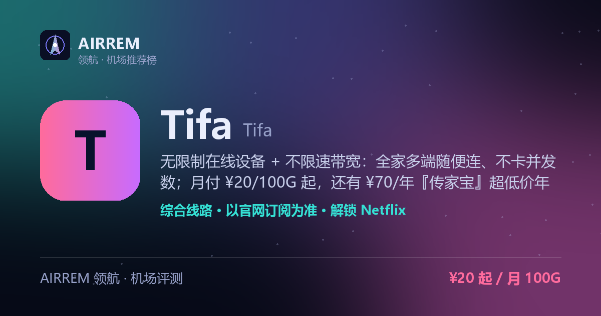

# Tifa机场官网与套餐 2026：综合机场，不限设备 · 平价口粮

> 无限制在线设备 + 不限速带宽：全家多端随便连、不卡并发数；月付 ¥20/100G 起，还有 ¥70/年『传家宝』超低价年付（月均约 ¥5.8）与一次性不限时买断（500G ¥200 / 1000G ¥370），支持各种流媒体解锁
>
> 最适合：**不限设备 · 平价口粮**。

👉 **[Tifa 官网注册入口](https://i.rtxk.us/i/muxcy6r)** ｜ [完整评测与横向对比](https://555736.xyz/tifa/)

---

## 基本信息

| 项目 | 内容 |
| --- | --- |
| 机场名称 | Tifa（tifa1） |
| 成立时间 |  |
| 线路类型 | 线路未公开（登录后查节点状态） |
| 支持协议 | 以官网订阅为准 |
| 流媒体解锁 | Netflix / Disney+ / YouTube |
| 节点地区 | 未公开（登录后在「节点状态」查看） |
| 计费方式 | 月付 / 年付 / 一次性不限时买断 |
| 起步价格 | ¥20 / 月 100G |
| 推荐场景 | 多设备/全家一起连，想要不限速又便宜的口粮机场 |

## 优点与缺点

**✅ 优点**

- 按量套餐无限制在线设备（传家宝档限 5 台），全家多端一起连、不受并发限制
- 无速度限制的带宽，不设速度上限
- 价格档位齐全：月付 ¥20/100G 到 ¥140/1000G，另有 ¥70/年『传家宝』超低价年付
- 计费灵活：月付 / 年付按月重置 + 一次性不限时买断（500G ¥200 / 1000G ¥370）

**⚠️ 缺点**

- 协议、线路类型（IEPL/中转/直连）官网未公开，晚高峰与解锁无第三方实测
- 第三方评测与社区口碑基本空白，属低知名度 / 较新机场
- 年付 / 一次性买断金额较高，新站大额预付有跑路风险，建议先月付小额验证
- 认准官方域名 tifa1.com，避免钓鱼假站

## Tifa 是什么

Tifa 是一家中文面板（V2board）的付费机场，官网 tifa1.com、官方 slogan『稳定低延迟』，走『平价口粮』路线。卖点集中在三点：按量套餐无限制在线设备、带宽不限速、支持各种流媒体解锁。

最有辨识度的是设备策略与价格：多数机场限制 3–5 台并发，Tifa 的按量套餐则不限设备数、全家多端随便连（仅低价『传家宝』档限 5 台）；价格上除常规月付，还有 ¥70/年的『传家宝』超低价年付（40G/月，月均约 ¥5.8）与一次性不限时买断套餐。

## 套餐与卖点

套餐分『按周期』（月付 100G/200G/500G/1000G 对应 ¥20/¥35/¥80/¥140，另有季付/半年/年付；年付传家宝 ¥70）与『按流量』（一次性不限时 500G ¥200、1000G ¥370）两类，多数标注无限设备（传家宝档限 5 台）、不限速、支持各种流媒体解锁。

- 无限制在线设备（传家宝档限 5 台）：不限并发，多设备 / 全家共享
- 无速度限制的带宽：不设速度上限
- 两种计费：月付 / 年付按月重置 + 一次性不限时买断

> 💡 『无速度限制』为官方宣传，实际速度受线路与晚高峰影响，建议先小额实测。

## 线路与协议（官网未公开）

与多数机场不同，Tifa 在未登录的公开页面没有标注线路类型（IEPL 专线 / 公网中转 / 直连）、传输协议、节点数量与覆盖地区——这些需要购买或登录后在『节点状态 / 订阅』里查看。第三方评测也基本空白，无法从外部核实其技术细节。

> 💡 线路与协议不透明是选购前要留意的点；建议先买最低月付档，导入订阅后自行确认协议、节点与解锁，再决定是否加码。

## 解锁与客户端

官方称『支持各种流媒体解锁』，常见如 Netflix、Disney+、YouTube 等，但无第三方实测佐证具体范围与稳定性。因协议未公开，客户端建议用兼容性广的 Clash Verge / Clash Meta / Shadowrocket / v2rayN，以官网订阅实际提供的协议为准。

## Tifa 套餐价格

| 套餐 | 价格 | 说明 |
| --- | --- | --- |
| 传家宝（年付） | ¥70 | 年付 · 每月 40G · 限 5 设备 · 不限速 · 月均约 ¥5.8 |
| Tifa 100G | ¥20 | 月付 · 每月 100G · 无限设备 · 不限速 |
| Tifa 200G | ¥35 | 月付 · 每月 200G · 无限设备 · 不限速 |
| Tifa 500G | ¥80 | 月付 · 每月 500G · 无限设备 · 不限速 |
| Tifa 1000G | ¥140 | 月付 · 每月 1000G · 无限设备 · 不限速 |
| 500G 不限时 | ¥200 | 一次性买断 · 500G 用完为止 · 无限设备 · 不限速 |
| 1000G 不限时 | ¥370 | 一次性买断 · 1000G 用完为止 · 无限设备 · 不限速 |

> 月付 / 年付套餐每月重置流量，一次性套餐为不限时买断、用完为止；按量套餐（100G–1000G 及不限时）无限制在线设备、仅低价『传家宝』档限 5 台设备；全部套餐无速度限制带宽、支持各种流媒体解锁；官网另有季付 / 半年 / 年付周期价，协议与线路类型未在未登录页公开、以登录后订阅为准，价格以官网实时为准。

## 常见问题

**Q：Tifa 真的不限设备吗？**

A：官网按量套餐（100G–1000G 及不限时买断）都标注『无限制在线设备支持』，不限制同时在线设备 / 并发数，适合多设备、全家共享；只有低价的『传家宝』年付档限 5 台设备。这是官方宣称，建议购买后自行实测确认。

**Q：Tifa 是专线还是中转？用什么协议？**

A：官网未登录页面没有公开线路类型（IEPL 专线 / 中转 / 直连）与传输协议，需要购买或登录后在『节点状态 / 订阅』里查看。建议先买最低月付档验证线路质量与解锁，再决定是否上年付或一次性买断。

**Q：Tifa 是新机场，靠谱吗？会不会跑路？**

A：目前第三方评测与 V2EX / NodeSeek / Telegram 等社区口碑基本空白，也未进入公开跑路黑名单——属低知名度或较新的小众机场。稳妥做法是先月付验证晚高峰与解锁，别一上来大额年付 / 买断，并认准官方域名 tifa1.com、再备一两家机场容灾。

## 适合谁 / 不适合谁

| 👍 适合 | 👎 不适合 |
| --- | --- |
| 多设备 / 全家共享、受够了并发限制的用户 | 只信老牌、要详尽第三方实测数据的用户 |
| 想要不限速、价格便宜的口粮或备用机场 | 追求 IEPL 专线明确标注、极致稳定的商务用户 |
| 想低价年付（传家宝）或一次性囤流量长期备用的用户 |  |

## 我们的结论

Tifa 是一家主打『不限设备 + 不限速』的平价口粮机场（官方 slogan『稳定低延迟』、后端 V2board 面板）：按量套餐都不限制在线设备数（仅低价传家宝档限 5 台），全家多端一起连不受并发限制，带宽也不设速度上限；价格档位很全——月付 ¥20/100G 到 ¥140/1000G，另有超低价 ¥70/年『传家宝』（40G/月、月均约 ¥5.8）与一次性不限时买断（500G ¥200、1000G ¥370）。注意它的协议与线路类型官网未在公开页披露、第三方评测与社区口碑基本空白，属低知名度新站，虽未进跑路黑名单，仍建议先月付小额验证解锁与晚高峰，再考虑年付/买断。

## 同类机场推荐

拿不定主意？可以再看看这几家同类型的：

- **[顺畅网络](https://555736.xyz/shunchang/)** — 年付白菜价 · 计费最全，¥11 起
- **[Mitce](https://555736.xyz/mitce/)** — 性价比 / 新手主推，¥4 起
- **[西部数据](https://555736.xyz/westdata/)** — 稳定专线党，¥17 起

全部 38 家机场的横向对比与选购方法论：**[信号塔 SignalTower · 机场大全](https://555736.xyz/airports/)**

---

数据更新：2026-07 ｜ 价格、套餐与优惠码以官网实时为准 ｜ 本仓库为第三方评测整理，与 Tifa 官方无隶属关系 ｜ 请遵守当地法律法规使用网络服务。

关键词：Tifa、Tifa机场、Tifa机场怎么样、Tifa机场靠谱吗、Tifa机场评测、Tifa机场官网、Tifa机场优惠码、Tifa机场注册、tifa1、tifa1.com、不限设备机场、不限速机场、平价口粮机场、传家宝套餐、不限时买断、一次性流量包、机场推荐、机场评测、科学上网、Netflix解锁、Clash订阅
